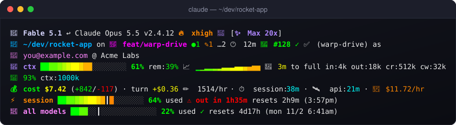
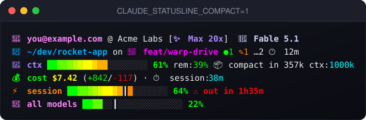

<div align="center">

# 🤖✨ claude-code-status-line

**A neon, emoji-packed, information-dense status line for [Claude Code](https://claude.ai/code).**

Model · live toggles · context window · cost · git · plan usage limits, all at a glance.

[](https://claude.ai/code)
[](#-requirements)
[](https://jqlang.org)
[](#-the-palette)
<br>
[](#-installation)
[](#-installation)
[](#-installation)
[](#-requirements)

<br>



<sub>A real render of <code>statusline.sh</code>, from a synthetic demo session. Regenerate with <code>bash tools/preview/build.sh</code>.</sub>

</div>

---

## 🚀 Why you'll love it

<table>
<tr>
<td width="33%" valign="top">

### 🧠 Context, felt
A green → red **fuel-gauge bar**, a **mood emoji** that sweats as you fill up (🧠 → 😅 → 🥵), a 📈 **sparkline** of the trend and a 🛫 **runway** ETA to full.

</td>
<td width="33%" valign="top">

### 💸 Spend, tracked
Session cost with a tiered emoji (🪙 → 💰 → 💸), **$/hr burn rate** (🐢 → 🔥), lines changed, ✏️ lines/hr and 💾 cache-hit %.

</td>
<td width="33%" valign="top">

### ⚡ Limits, exact
The same 5-hour, weekly and **per-model** rows as claude.ai › Usage, read from the same endpoint and kept warm by a background refresher.

</td>
</tr>
<tr>
<td valign="top">

### 🌿 Git, at a glance
Branch with ⇡⇣ ahead/behind, ●staged ✎modified …untracked, 🕐 last-commit age, 🌳 worktree awareness and a 🔀 **PR badge** colored by review state.

</td>
<td valign="top">

### 🎛️ Toggles, visible
Effort (🐢 ⚙️ ⚡ 🔥 🚀), 💭 thinking, 🏎️ fast mode, 🎨 output style, 🛠️ agent and vim mode. You always know how the session is set up.

</td>
<td valign="top">

### 🏅 Models, ranked
Every model family gets a **medal-tier color**, and ↩ a breadcrumb remembers what you switched from mid-session.

</td>
</tr>
</table>

### 🏅 Model tiers

| | Family | Color |
|:-:|---|---|
| 💎 | **Fable** |  |
| 🧊 | **Mythos** |  |
| 🥇 | **Opus** |  |
| 🥉 | **Sonnet** |  |
| 🍃 | **Haiku** |  |

### 🎨 The palette

Every section gets its own vivid 256-color accent and an emoji glyph. Labels render bright white on dark terminals (and grey on light ones).


---

## 🔭 What it shows

**🪪 Line 1 — identity & live state**
- 🤖 **model**, tinted by tier like a medal ladder (Fable = platinum, Mythos = icy platinum, Opus = gold, Sonnet = bronze, Haiku = green) + version
- ↩ **model-switch breadcrumb** — the model you switched from, once you change mid-session
- **effort badge** tracking `/effort`: 🐢 low · ⚙️ medium · ⚡ high · 🔥 xhigh · 🚀 max
- 💭 **thinking** (when extended thinking is on) · 🏎️ **fast** (when `/fast` is engaged)
- 🎨 **output style** (when not `default`) · 🛠️ agent · vim mode · ✨ **plan**
- 📂 **directory** (`~`-abbreviated, deep paths collapsed to `~/…/parent/base`) · 🌳 **worktree** badge — inside a git worktree, 📂 shows the *main* repo and 🌳 names the worktree
- `(owner/name)` repo identity (only when the folder is named differently), 🌿 **branch** + git status, 🕐 **last-commit age**, 🔀 **PR** with CI status: ✅ passed · ❌ failed · ⏳ running (via `gh pr checks`, refreshed in the background every 60s; `CLAUDE_STATUSLINE_CI=0` turns it off)
- session name · 👤 **account** & org (a personal account's auto-named `<email>'s Organization` is hidden)
- ordered by priority: Claude Code cuts an over-wide line from the right, so a narrow terminal loses the session name and account before the branch

**🧠 Line 2 — context window**
- 🧠 **mood emoji** by fullness: 🧠 (<70%) → 😅 (70–89%) → 🥵 (≥90%)
- gradient **usage bar** (green → yellow → orange → red as it fills)
- used % · remaining % · 📈 **usage sparkline** (trend over time) · 🛫 **runway** (ETA to full)
- token breakdown: input, output, cache read/write · 💾 **cache-hit %** · context size
- ⚠️ **200k+** badge when the conversation crosses 200k tokens

**💰 Line 3 — cost & timing**
- **cost emoji** by tier: 🪙 (<$1) · 💰 ($1–$9) · 💸 (≥$10) + total cost
- lines changed (+added / −removed) · **turn cost**, what everything since your latest prompt has cost (green under $0.10, yellow under $1, red above) · ✏️ **lines/hr** velocity
- ⏱️ session duration · 🛰️ time spent waiting on the API · 💵 **cost velocity** ($/hr with a 🐢→🔥 burn emoji)

**⚡ Lines 4–5 — plan usage limits (mirrors claude.ai › Settings › Usage)**
- ⚡ **session** (5-hour window) · 📅 **all models** (weekly) · ✨ **per-model weekly** rows (e.g. *Fable*) · 💳 **usage credits** toggle
- the same rows, values, and floor-rounded percentages as claude.ai's Usage panel, with gradient bars and reset countdowns (weekly resets show days + the absolute day/time, e.g. `5d18h (sun 8/9 3:00am)`)
- ┃ **pace tick** on each bar marks where usage would sit at an even burn through the window. Fill short of it gets a ✓; fill past it projects when the window runs dry, `⚠ out in 1h20m` (kept even in compact mode)
- kept current by a [background refresher](#-usage-meter-refresh) rather than only being fetched when a render notices the cache expired

### 🌿 Git status

Next to the branch, from a single `git status` call:

| Marker | Meaning |
|--------|---------|
| `⇡n` / `⇣n` | commits ahead / behind upstream |
| `●n` | staged changes |
| `✎n` | modified (unstaged) |
| `…n` | untracked files |
| `✓` | clean working tree |
| `🕐 <age>` | time since the last commit — turns amber when uncommitted work sits on a commit older than 30 min |

The PR badge (`🔀 #123`) is colored by review state: approved ✓ (green), changes requested ✗ (red), pending (yellow), draft ✎ (grey).

### 📈 Context-usage sparkline & runway

The 📈 sparkline (`▁▂▃▄▅▆▇█`) tracks the context used-% over time. History is kept per-session in a temp file as `(timestamp, used-%)` pairs, sampled at most once every 8 seconds (so it reflects real elapsed time, not render frequency) and capped at the last 20 points. Stale files from old sessions are swept automatically.

The 🛫 **runway** projects an ETA to a full context window from that history, shown only when context is genuinely climbing over a ≥30s window — so it stays quiet during noise, flat usage, or when the context is compacted and usage drops.

### 🧮 Derived metrics

- **💾 Cache-hit %** — `cache_read ÷ (input + cache_creation + cache_read)`, colored green (≥80%) / yellow (≥50%) / orange. Higher = more prompt-cache reuse = cheaper & faster.
- **💵 Cost velocity** — session spend rate ($/hr) with a burn emoji: 🐢 <$1 · 🚶 $1–$4 · 🏃 $5–$14 · 🔥 ≥$15 per hour.
- **✏️ Code-change velocity** — total lines touched per hour over the session.
- **↩ Model-switch breadcrumb** — the distinct models used this session are tracked (per-session, recency-ordered); when you change models, line 1 shows where you came from.

### ⛽ Bar gradient ("fuel gauge")

Bars color each cell by its position along a green → red ramp, so color signals how full something is: a low bar is all green ("plenty of room"), and it warms through yellow and orange to red as it fills.

### 🎯 Accurate usage limits (claude.ai parity)

The statusline JSON that Claude Code pipes in only ever carries the 5-hour session window and the all-models weekly window — the **per-model weekly limits** (e.g. the "Fable" row) and the **usage-credits** state shown on claude.ai never appear in it. To display those, the script queries `GET https://api.anthropic.com/api/oauth/usage` — the *same endpoint the claude.ai Usage panel and Claude Code's own `/usage` screen read* — so the numbers match claude.ai exactly.

How it behaves:

- **Non-blocking** — the response is cached to a temp file (default TTL 180s, tune with `CLAUDE_STATUSLINE_USAGE_TTL`); refreshes happen in a detached background job, so rendering never waits on the network. Data older than 10 minutes is flagged `(as of Xm ago)`.
- **Auth** — the OAuth token is read from `~/.claude/.credentials.json` (Linux) or the macOS Keychain (`Claude Code-credentials`), used for the one HTTPS call to `api.anthropic.com`, and never written to disk. On macOS the first call may pop a Keychain permission prompt for `security` — click "Always Allow" once.
- **Opt-out** — set `CLAUDE_STATUSLINE_USAGE_API=0` to disable the fetch entirely; the limits section then falls back to the stdin-provided windows.

### 🗄️ Rate limit caching (fallback path)

Claude Code only includes rate limit data in the statusline JSON when it receives fresh headers from the API. Without caching, the rate limit bars disappear between messages. This script persists the last known values to a temp file and shows a `(cached Xm ago)` label when displaying stale data, so the bars are always visible even when the usage endpoint is disabled or unreachable.

## 📋 Requirements

- [Claude Code](https://claude.ai/code)
- `jq` on PATH (comes with Git Bash on Windows; `brew install jq` on Mac)
- Bash (Git Bash on Windows, native on Mac/Linux)
- A terminal with emoji and 256-color support (iTerm2, Ghostty, VS Code, Terminal.app, most modern terminals)

## 📦 Installation

```bash
git clone git@github.com:gigadude1982/claude-code-status-line.git
cd claude-code-status-line
bash install.sh
```

The install script copies `statusline.sh` to `~/.claude/statusline.sh` and prints the exact block to add to `~/.claude/settings.json`.

### ✍️ Manual settings.json update

Add the `statusLine` block printed by `install.sh` to `~/.claude/settings.json`:

**Mac / Linux**
```json
"statusLine": {
  "type": "command",
  "command": "/Users/<you>/.claude/statusline.sh",
  "padding": 2
}
```

**Windows (Git Bash)**
```json
"statusLine": {
  "type": "command",
  "command": "C:\\Program Files\\Git\\bin\\bash.exe /c/Users/<you>/.claude/statusline.sh",
  "padding": 2
}
```

## 🎛️ Configuration

### 🌗 Light vs dark backgrounds

Labels/secondary text render **white on dark** backgrounds and **grey on light** ones. The script detects the background from `$COLORFGBG` when the terminal exports it; otherwise it assumes dark (the common case, e.g. macOS Terminal.app). If you use a light-background terminal that doesn't set `COLORFGBG`, force it:

```bash
export CLAUDE_STATUSLINE_BG=light   # or: dark
```

### 🔄 Usage-meter refresh

The usage rows come from `GET /api/oauth/usage`, cached to a temp file. A small **background refresher** re-fetches that cache on a timer and keeps it warm, so a render always has a current snapshot to draw.

Worth being precise about what this does and doesn't fix. Claude Code runs the statusline command only when session state changes — it has no idle timer — so nothing the script does can make the *drawn* line repaint while a pane sits idle. What the refresher removes is the staleness: previously the snapshot was only re-fetched by a render that noticed the cache had expired, and that fetch landed a render *late*, so the meters showed the previous snapshot and caught up one render behind. Now the first render after an idle pane wakes up (a keystroke is enough) draws numbers that are seconds old rather than minutes.

One refresher runs per uid + config dir, shared by every session, pane and worktree — so a grid of sessions costs one poller, not one per pane. It claims a pid file atomically, stands down if another instance takes over, retires once no session has rendered for `CLAUDE_STATUSLINE_USAGE_IDLE` seconds, and backs off exponentially (up to 15 min) when the endpoint fails, since that endpoint rate-limits and polling it harder is the wrong answer.

| Variable | Default | Meaning |
|----------|---------|---------|
| `CLAUDE_STATUSLINE_USAGE_DAEMON` | `1` | Set `0` for the old refresh-on-render behaviour |
| `CLAUDE_STATUSLINE_USAGE_INTERVAL` | `60` | Seconds between refreshes |
| `CLAUDE_STATUSLINE_USAGE_IDLE` | `1800` | Retire after this long with no render from any session |
| `CLAUDE_STATUSLINE_USAGE_TTL` | `180` | Cache lifetime for the refresh-on-render path (used when the refresher is off) |
| `CLAUDE_STATUSLINE_USAGE_API` | `1` | Set `0` to skip the endpoint entirely and use only the windows Claude Code sends on stdin |

If the snapshot does go stale — endpoint down, or credits exhausted and the endpoint rate-limiting — the rows say so with an `(as of Xm ago)` note rather than quietly showing old numbers.

### 🤏 Compact mode

Set `CLAUDE_STATUSLINE_COMPACT=1` to trim the line down to the essentials — model, plan, directory + worktree, branch + git status, the context bar, cost, and the usage-limit bars — hiding the many secondary badges (effort/thinking/fast/style/session/account/repo/PR, sparkline/runway/token breakdown, turn cost, api-wait/velocities, and the "used"/reset annotations on the limit bars). Everything is still computed the same way; the optional segments are just hidden.

```bash
export CLAUDE_STATUSLINE_COMPACT=1
```



## ⬆️ Updating

```bash
git pull
bash install.sh
```

## ✨ Plan detection

The script reads `~/.claude.json` to determine your subscription tier and displays it in the header:

| Tier | Label |
|------|-------|
| `default_claude_max_5x` | Max 5x |
| `default_claude_max_20x` | Max 20x |
| `default_claude_max_1x` | Max 1x |
| `claude_pro` | Pro (or Max if extra usage enabled) |

## 🛟 Graceful degradation

Every field is parsed defensively (`// empty`), so badges only appear when their data is present. Older Claude Code versions that don't emit newer fields (effort, thinking, fast mode, PR, repo, etc.) simply render without those badges — nothing breaks.

---

<div align="center">

Made with 🤖, ☕ and way too many emoji.<br>
<sub>If it made your terminal a little happier, drop a ⭐.</sub>

</div>
